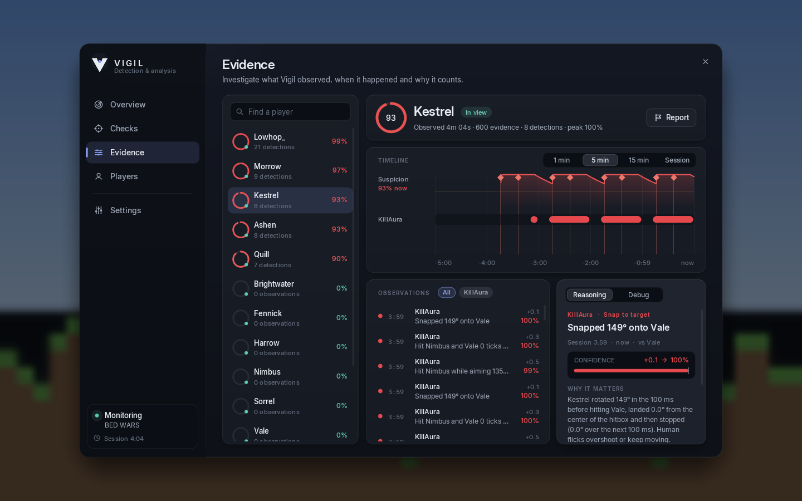

<p align="center"></p>

<h1 align="center">Vigil</h1>
<p align="center">Cheat detection and player analysis for Hypixel on Lunar Client 1.8.9</p>



Vigil observes the players around you, measures their behavior against what vanilla Minecraft
allows, and reports only what it can explain. Every detection is backed by recorded evidence:
the measured values, the limits they were compared against and the reasoning that connects them.

## Highlights

- **Eleven checks on one framework:** KillAura, Reach, AutoClicker, Velocity, AutoBlock,
  Speed, BHop, NoSlow, Scaffold (Keep-Y), Scaffold (Flat) and LegitScaff. Each has
  independent indicators, a confidence model with decay, and an evidence gate.
- **Evidence Explorer:** a timeline with the suspicion curve, per-check evidence lanes and
  detection markers, plus an inspector that explains each observation.
- **Player analysis:** reach distributions, click timing, movement profile, confidence history
  per check, pattern insights and cross-session history.
- **Fully configurable:** presets, thresholds, indicator weights, confidence behavior, optional
  sampling and debug output, each with an explanation and a visible default.
- **Native interface:** five themes, anti-aliased Inter typography, an original icon set and
  purposeful motion.
- **Private by design:** no network requests and no API keys. Data stays in `vigil/` next to
  the DLL.

## Use

1. Start Minecraft 1.8.9 in Lunar Client and join Hypixel.
2. Run `VigilLauncher.exe` (keep it next to `Vigil.dll`).
3. Press **Right Shift** or type `/vigil` in chat. `/vigil <player>` opens that player's
   evidence; `/vigil reset` starts a new session.

Detections arrive as an on-screen notification and a chat line. Hover the chat line to read the
evidence; clicking it runs `/wdr` (configurable).

## Build

Requirements: Visual Studio 2022 Build Tools (x64), CMake ≥ 3.20, and a JDK for the JNI headers.

```powershell
cmake -S . -B build -A x64
cmake --build build --config Release
ctest --test-dir build -C Release          # detection test suite
build\Release\VigilPreview.exe             # UI + engine with a simulated arena
build\Release\VigilPreview.exe --shot evidence.png --page evidence --theme 3
```

The embedded Java shims (`src/game/bytecode/`) are generated from `java/src` with
`python tools/build_java.py`. Brand assets are generated with
`python tools/make_brand_assets.py`.

## Layout

```
src/core/        logging, JSON, typed settings registry
src/detection/   detection framework and checks (pure C++, unit-tested)
src/game/        Minecraft adapter over JNI: sampler, game context, alerts, Suspect Highlight
src/ui/          native OpenGL interface: renderer, fonts, icons, themes, widgets, pages
src/platform/    DLL bootstrap, render/input hooks, launcher
java/            sources of the three JVM shim classes
tests/           detection scenarios on simulated vanilla physics
tools/           UI preview harness, Java and brand asset builders
docs/            design and reports
```

## Documentation

[Plan](PLAN.md) · [Detection framework](docs/DETECTION_FRAMEWORK.md) ·
[Detection redesign](docs/DETECTION_REDESIGN.md) · [UI/UX](docs/UI_UX.md) ·
[Brand](docs/BRAND.md) · [Rebrand report](docs/REBRAND_REPORT.md) ·
[Feature removal](docs/FEATURE_REMOVAL.md) · [Technical debt](docs/TECH_DEBT.md) ·
[Implementation summary](docs/IMPLEMENTATION_SUMMARY.md)

Inter typeface © The Inter Project Authors, SIL Open Font License 1.1 (`assets/fonts/LICENSE-Inter.txt`).
