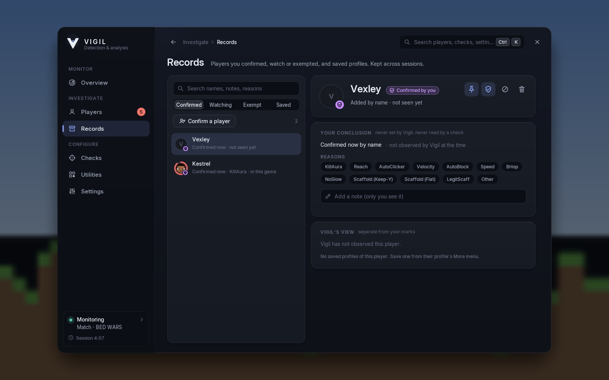

# Finalization, validation & Rust preparation — report (1.0-dev.9)

The plan, with every audit as it stood before any code changed, is in [`PLAN.md`](../PLAN.md).
This report records what changed, how it was verified, and what still needs a live client. The
Rust study is [`RUST_PLAN.md`](../RUST_PLAN.md).

Contents: §1 Final implementation summary · §2 Verification · §3 Validation audit · §4 Testing
audit · §5 Workflow validation report · §6 Live validation · §7 Profile persistence report ·
§8 Detection philosophy report · §9 Accessibility audit · §10 UI/UX report · §11 Runtime version
protection & release naming · §12 Documentation report · §13 Rust feasibility report ·
§14 Known limitations.

---

## 1. Final implementation summary

| Area | Result |
|---|---|
| **Records** (new page) | Confirmed · Watching · Exempt · Saved. Search across names, notes and reasons; add anyone (this game, this session, or any username); review a confirmation (when, Vigil's confidence then, editable reasons, private note); remove with a two-step confirm |
| **Exemptions** | Per-player exemption: listed, never judged (no evidence, detections, alerts, briefing, highlight). From a profile's More menu, Records, or Settings → Exemptions |
| **Add by name** | Name-added marks bind to the first real (v4) account with that name and follow it; nicks never take them |
| **Saved profiles** | Save, export (`exports/*.vigil-profile.json`), import (Explorer-copied file, path or JSON on the clipboard, or the imports folder); viewed read-only with the same Summary/Evidence/Behavior tabs |
| **Behavioral envelopes** | Every observation records expected (vanilla, in context) · limit · observed · context; the inspector leads with *Expected vs observed* and why the difference is suspicious. No threshold or severity changed |
| **Uncertain language** | Below Elevated, summary surfaces say "Unusual movement / combat / building" instead of a check name |
| **Match cleanup** | Detection cards, the briefing and "new detection" badges of the previous game are cleared; briefings are bound to their match; stall windows end with the world |
| **Keyboard & accessibility** | Tab/Shift+Tab through every control, Enter/Space activate, arrows for sliders/choices/tabs/dropdowns/lists, focus ring, tooltips on focus; Accessibility section (contrast, focus ring, motion, sounds) |
| **Sliders** | Typed values (click the number or Enter on the slider), Shift ×10 steps, Home/End |
| **Checks sidebar** | Ambiguous colored dot replaced by an observation-count badge (red only with detections) and a missing-signal warning |
| **Denickers** | Moved to Utilities → Identity tools with status and setup; Settings → Identity removed |
| **UI sounds** | Optional (off by default), five synthesized sounds for out-of-view events and durable actions only |
| **Icons** | Records, Save, Import, Exempt, UserPlus, Sound, More, Trash, Edit, Accessibility on the 20-unit grid |
| **Diagnostics** | Status → Diagnostics: copy/save report (no names), game-binding report, trace recording |
| **Runtime version protection** | Build ID in both binaries; verified extraction; running-runtime detection; per-process claim; failure reasons to the launcher; `--self-check`, `--version` |
| **Release** | `Vigil-<version>.exe` + `SHA256SUMS`; Validate → gate → publish; a version is never overwritten |
| **Validation infrastructure** | Shared test framework, simulator, 3 new suites, traces + `VigilReplay`, golden trace, determinism, repo checks |
| **Architecture prep** | Library split enforced by the linker; exact JSON numbers; versioned formats; engine contract |

New code: `src/detection/{snapshot,trace,replay}.*`, `src/platform/runtime_guard.*`,
`src/ui/{page_records,records,sound}.*`, `tests/{test_framework,sim,scenarios}.h`,
`tests/{records,validation,ui_logic}_tests.cpp`, `tools/replay/`, `tools/ci/validate_repo.py`,
`.github/workflows/validate.yml`. Substantially changed: marks, engine, evidence, widgets, app,
players, evidence inspector, checks, settings, status, utilities, search, launcher, runtime,
sampler, release workflow, CMake.

## 2. Verification

| Check | Result |
|---|---|
| Full build, MSVC 19.44 `/W4 /permissive- /WX` (CI configuration), all targets | ✅ 0 warnings, 0 errors |
| `detection` | ✅ 32 tests, **152** expectations (unchanged: no detection outcome moved) |
| `features` | ✅ 7 tests, 52 expectations |
| `records` (new) | ✅ 11 tests, 78 expectations |
| `validation` (new) | ✅ 7 tests, 169 expectations |
| `ui_logic` (new) | ✅ 5 tests, 60 expectations |
| Golden trace (`VigilReplay --expect`) | ✅ "outcome matches the expectation" |
| `Vigil.exe --self-check` | ✅ all six checks; embedded runtime SHA-256 = built `Vigil.dll` SHA-256 |
| Falsifiability | ✅ removing the exemption rule from `Engine::shouldAnalyze` fails 2 expectations in `records` and 2 in `validation`; the envelope invariant caught an off-by-boundary assumption in the test itself (inclusive limits) |
| Repo checks (`validate_repo.py metadata · links · golden`) | ✅ after fixing what they found: 11 broken links in the archived plans, release notes not yet naming the version |
| Preview review | ✅ Records (all tabs, add picker, saved profile), Players (exempt row, More menu), Evidence (envelope), Checks (badges), Settings (Accessibility, keyboard focus ring after 13 Tabs; Enter activates), Utilities (Identity tools), Status (Diagnostics) |
| `actionlint` | ⚠️ not run locally (downloading the binary was not permitted in this environment); it is the first job of Validate in CI |

## 3. Validation audit — outcome

| # (PLAN §5) | Finding | Outcome |
|---|---|---|
| V1 | One job built, tested and published | ✅ Reusable **Validate** + **Release** (gate → publish from the validated artifact) |
| V2 | Workflows never linted | ✅ `actionlint` job |
| V3 | Same version could be republished | ✅ Gate refuses an existing tag; summary explains |
| V4 | Exe could embed a stale DLL | ✅ Build ID + self-check + embedded hash = built DLL hash; re-checked before publishing |
| V5 | Version consistency assumed | ✅ `metadata` check (format, changelog entry, release notes); build ID tied to the commit |
| V6 | Warnings didn't fail CI | ✅ `VIGIL_WARNINGS_AS_ERRORS` |
| V7 | Write token everywhere | ✅ `contents: read` by default; write only in Publish |
| V8 | Java shims | ✅ kept informational, documented |
| V9 | No UI smoke | ✅ every page rendered on the runner (informational; software OpenGL) |
| V10 | Docs links unchecked | ✅ `links` check (it found 11 real problems on its first run) |

## 4. Testing audit — outcome

| # (PLAN §4) | Gap | Outcome |
|---|---|---|
| T1 | Duplicated harness | ✅ `tests/test_framework.h` (filters, `--list`, summary) used by all five suites |
| T2 | Marks untested beyond basics | ✅ semantics, search, add-by-name binding, format guards |
| T3 | No profile I/O tests | ✅ round trip, remapping, hostile files, store operations |
| T4 | Lifecycle implicit | ✅ queue → match → post-game → new world, carry-over per check |
| T5 | Confidence indirect | ✅ invariants (bounds, monotonicity, half-life, gate, carry-over, cooldown) |
| T6 | Player states scattered | ✅ one table: plain, teammate, exempt, local, NPC |
| T7 | No determinism check | ✅ two engines; through the trace format |
| T8 | No recorded-input path | ✅ traces, `VigilReplay`, golden trace (+ in-game recording) |
| T9 | UI logic untested | ✅ numeric parsing, focus order, wording, sounds, contrast |
| T10 | Falsifiability manual | ✅ documented procedure (VALIDATION.md §3) with this pass's example |

Coverage map: **detection correctness** (detection, golden, envelopes) · **utility correctness**
(features) · **investigation correctness** (records: marks, snapshots) · **player-state handling**
(validation: state table; records: exemption) · **lobby & match awareness** (validation:
lifecycle; detection: match tracker, post-game, queue) · **confidence generation** (validation:
invariants; detection: confidence model, carry-over).

## 5. Workflow validation report

**Before:** one workflow, one job: build → test → (informational shims) → package → publish, on
every push to master with a write token; no linting, no version or artifact checks, republishing
possible.

**After:** see [RELEASE_PROCESS.md](RELEASE_PROCESS.md) for the full pipeline and the risk →
check table. End-to-end path for a release:

1. Validate (lint · metadata · build/test/self-check · complete) — any failure stops everything.
2. Gate — `run: true` and the tag is new; otherwise a summary explains why nothing was published.
3. Publish — downloads the *validated* artifact, re-runs the self-check, compares hash and version,
   packages `Vigil-<version>.exe` + `SHA256SUMS`, publishes, then verifies the release's assets.

**Failure cases now covered:** broken workflow syntax; malformed version; missing changelog or
release notes; broken docs links; corrupt golden files; compiler warnings; any failing expectation;
golden outcome drift; exe/runtime version or build mismatch; stale embedded runtime; binary not from
the commit; artifact changed between validation and publishing; existing tag; missing release
files; size mismatch after upload.

**Remaining risks:** the UI smoke job is informational until proven stable on hosted runners; code
signing is not part of the pipeline (no certificate); live behavior is still validated by hand
(§6).

## 6. Live validation

[LIVE_VALIDATION.md](LIVE_VALIDATION.md) now lists every live-only system with its status
(✅ confirmed / ⚠️ unconfirmed / 🆕 new), exact steps, the evidence to look for and what to send
back, plus a per-release checklist. New tools reduce guesswork: the diagnostics report (versions,
hooks, signals, game bindings, engine, changed settings, log without detection lines), the binding
report (missing members and obfuscated fallbacks), trace recording and the launcher's own log and
failure reasons.

Not validated in game in this pass (no live client here): L3–L12 carried over from dev.7/dev.8 and
the new L13–L18.

## 7. Profile persistence report

**Design.** A saved profile is an investigation frozen when the user saves it: records, every
observation with its values (and re-derived envelope), detections, timeline, behavior statistics,
the user's marks and an identity summary. It lives in Records → Saved and opens read-only in the
same tabs as a live profile, with its own session clock.

| Action | Where | Result |
|---|---|---|
| Save | Profile → More → Save profile | `profiles/<name>-<date>.json`; banner confirms |
| Export | Profile → More → Export, or Records → Saved → Export | `exports/<id>.vigil-profile.json` |
| Import | Records → Saved → Import | From a file copied in Explorer, a copied path, profile JSON on the clipboard, or files in `imports/`; when there is nothing to import the imports folder opens with instructions |
| Note | Records → Saved | Saved with the file |
| Delete | Records → Saved | Two-step confirm |

**Format.** `vigil-profile`, format 1, JSON. Checks and indicators are referenced by id, so a file
opens in any later version; unknown checks are dropped and listed on the profile. Imports are
bounded (8 MB, 600 observations, 200 detections, 1 500 timeline entries, 16 values, 2 000-character
strings), validated, and re-serialized from what Vigil understood — nothing from a file is kept
verbatim or executed. Newer formats are refused with "Update Vigil to open it".

**Tests:** round trip (every observation, detection and per-check count; envelope identical),
remapping to a reader with a missing check and reordered checks, malformed/oversized/wrong-kind/
newer files, store save/list/note/export/import/pending/delete.

## 8. Detection philosophy report

Vigil models **legitimate play** and treats deviations as **evidence**, never as verdicts.

1. **Expected behavior is first-class.** Each observation's envelope states the vanilla expectation
   *in the player's context* (movement multiplier from attribute and potions, stair tolerance, ping
   and relay cadence for knockback, flat-jump air time), the edge of what legitimate play can
   produce (the limit), and what was observed.
2. **The envelope is built from context, not from a fixed number.** Speed's limit is
   `vanilla × multiplier × terrain`; Velocity's window follows the victim's latency and its expected
   push follows the run-in velocity; NoSlow's limit decays with ground friction from the speed at
   item use. Static thresholds remain only as the tolerance around those models.
3. **Deviation produces evidence with a strength.** Severity grows with the distance beyond the
   limit and is scaled by data quality (regular updates). The inspector now says *how far* beyond
   ("18 % beyond what legitimate play can produce") and why it is suspicious.
4. **Evidence changes confidence; it never punishes.** Confidence has diminishing returns, decays
   during normal play, holds while unobserved, is halved in a new game and needs an evidence gate
   before a detection. Vigil never confirms, exempts or reports anyone on its own.
5. **Uncertainty is stated as uncertainty.** Below Elevated, summaries name the kind of behavior,
   not a check.

Explicit expectations now exist for Speed (sustained, ground), BHop (chain speed, flat-jump air
time), Reach and Velocity (horizontal push); other indicators derive the envelope from their
limited measure. Tests assert that every observation has an envelope, lies at or beyond its limit,
and that the expectation lies on the legitimate side. Detection outcomes are unchanged (152/152,
golden trace identical).

## 9. Accessibility audit — outcome

| Area (PLAN §8) | Outcome |
|---|---|
| Keyboard focus | ✅ Every pressable control is focusable in drawing (reading) order; Tab/Shift+Tab; focus scrolls into view; a removed control releases focus after a short grace |
| Focus visibility | ✅ 2 px accent ring with a soft halo; shown after keyboard use, hidden by a click, or always (setting) |
| Controls | ✅ Enter/Space activate; sliders: arrows, Shift ×10, Home/End, Enter to type; segmented/tabs: ←/→; dropdowns: Enter, ↑/↓, Enter, Esc; text fields start typing when focused |
| Lists | ✅ Players and Records: ↑/↓ move the selection, keep focus, scroll |
| Tooltips | ✅ Shown for the focused control |
| Modal overlays | ✅ Search and onboarding trap focus (controls underneath are not focusable) |
| Readability | ✅ Higher text contrast option for every theme (tested: faint text gains contrast in all built-in themes; identity colors unchanged) |
| Motion | ✅ Moved to Accessibility |
| Discoverability | ✅ Keyboard reference in Keybinds; search finds keyboard, focus, contrast, sounds |

## 10. UI/UX report

**Information architecture.** INVESTIGATE now has **Players** (live) and **Records** (yours,
across sessions). Denickers joined the other optional tools in Utilities. Settings gained
Accessibility and lost Identity. Ctrl+1…7 reach every page.

| Topic | Decision |
|---|---|
| **Check sidebar indicators** | The dot's color came from `severity(30 + 4 × count)`: after eight observations every dot was alarm red, with no tooltip, and it looked like the roster's "new detection" dot. Replaced by a number badge (observations this session; red only when the check detected someone; tooltip with counts) and a separate warning glyph when a required game signal is missing |
| **Denicker placement** | Settings → Identity held four truncated rows; status lived on Status, results in profiles. Utilities → Identity tools now shows both denickers as cards with status, toggle, setup and privacy, next to the other opt-in tools. Profile "Set up" buttons and search lead there |
| **Confirmations** | Expanded into Records: confirm anyone, search, review, edit reasons, notes, Vigil's confidence then |
| **Exemptions** | User exemptions added; Settings → Exemptions shows who is exempt and links to Records |
| **Uncertain detections** | Category language below Elevated on summary surfaces |
| **Match cleanup** | Previous game's cards, briefing and badges cleared |
| **Information density** | Profile header: at most three facts (earlier sessions and "held while away" moved to the tooltip); inspector: measure and expectation shown once (envelope), other values under "Also measured"; record headers keep actions on one row and the profile link on the second |
| **Sliders** | Typed values, precision steps, Home/End |
| **UI audio** | Sound helps only for events outside the user's view (a detection notification while playing, the match briefing) and for durable decisions (confirm/exempt, save/export/import, errors). Never for hover, clicks, navigation or toggles. Off by default, one volume, synthesized soft tones peaking at 35 % of full scale, no clicks at start/end (tested) |
| **Iconography** | Coherent additions on the 20-unit grid: Records (archive box), Save (bookmark), Import (tray, arrow in — mirror of Export), Exempt (crossed ring, neutral color, never severity), UserPlus, Sound, More, Trash, Edit, Accessibility. Exempt badge on the halo uses the neutral muted color so it can never be read as a verdict or a severity |

## 11. Runtime version protection & release naming

See [RELEASE_PROCESS.md](RELEASE_PROCESS.md) §4–§5. Every pair (exe ↔ embedded ↔ extracted ↔
running, runtime ↔ runtime, data ↔ runtime) has a check and a clear message; nothing ever loads a
second runtime into a game. Release files are named `Vigil-<version>.exe` (hyphen: survives
GitHub's asset renaming, URL- and shell-safe, sorts by version).

## 12. Documentation report

| Document | State |
|---|---|
| [README](../README.md) | Updated: download name, Records, keyboard, validation links |
| [ARCHITECTURE](ARCHITECTURE.md) | **New**: layers, data flow, threads, persistence, modules, engine contract, boundaries |
| [VALIDATION](VALIDATION.md) | **New**: suites, writing tests, falsification, traces/golden, invariants, CI, local CI |
| [LIVE_VALIDATION](LIVE_VALIDATION.md) | **New**: tools, status of every live-only system, steps/evidence, per-release checklist |
| [RELEASE_PROCESS](RELEASE_PROCESS.md) | **New**: publishing, pipeline, risk → check table, naming, version protection |
| [RUST_PLAN](../RUST_PLAN.md) | **New**: feasibility study and roadmap |
| [RELEASE_NOTES](RELEASE_NOTES.md) | Rewritten for 1.0-dev.9 (release body) |
| [TECH_DEBT](TECH_DEBT.md) | Refreshed |
| PLAN | Rewritten for this pass; dev.8 plan archived in [history](history/) with links fixed |

## 13. Rust feasibility report

Full study: [RUST_PLAN.md](../RUST_PLAN.md). In short: feasible for every layer; migrate the
detection engine first (pure, 5.5 k lines, provable bit-for-bit with traces and a shadow mode),
then services, UI and launcher; keep the JNI adapter and the hooks in C++ longest (only verifiable
in game, highest crash impact, lowest marginal benefit). Interop through a narrow, versioned C ABI
with data-only outputs; every FFI entry wraps panics. Preparation done in this pass: linker-enforced
library split, trace format, outcome comparison, golden trace, determinism tests, exact JSON,
versioned formats, documented engine contract. Next C++ step before any Rust: inject an immutable
engine configuration instead of `Setting*` reads (P1).

## 14. Known limitations

| Item | Note |
|---|---|
| Live validation | L3–L18 need Lunar Client ([LIVE_VALIDATION.md](LIVE_VALIDATION.md)) |
| `actionlint` | Runs in CI; not run locally in this pass |
| UI smoke on CI | Informational until stable on software OpenGL |
| Name-added marks | Bind to real (v4) accounts only; a player who is always nicked never binds (the mark remains "added by name") |
| Clipboard import paths | Converted to the ANSI code page; a file whose name has characters outside it must be placed in the imports folder instead |
| Saved profiles | Contain player names; they are the user's files and are only shared if the user exports and sends them |
| Code signing | Not in the pipeline (no certificate); SHA256SUMS remains the integrity check |
