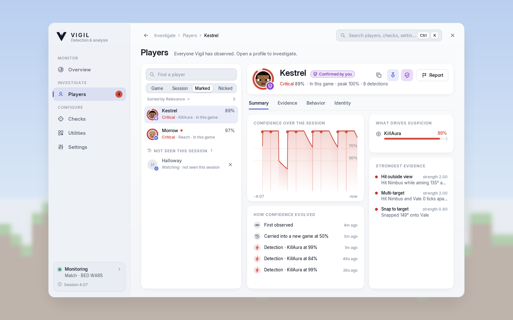
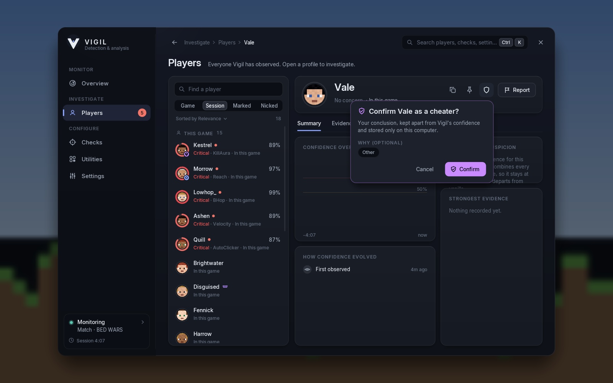

# Quality, relevance & UX pass — report (1.0-dev.8)

The plan, with every audit as it stood before any code changed, is in
[`history/PLAN-quality.md`](history/PLAN-quality.md).
This report records what changed, how it was verified, and what still needs a live client.

---

## 1. Final implementation summary

| Area | Result |
|---|---|
| **Interface scaling** | Root cause fixed: the scale is applied when a drag on its slider ends (keyboard/wheel steps apply at once); the mouse is kept in window pixels and converted every frame; the effective scale moves in 1/20 steps; unused font atlases are freed; springs snap when the layout moves; the window settles in 260 ms and the scale row stays in view and flashes |
| **Relevance** | Game phases (Lobby · Queue · Match · Post-game · Replay) and scenes. The roster defaults to **This game**; Session, Marked and Nicked are one click away; earlier players are one link away. Records are pruned beyond 400 |
| **Lobby & match awareness** | Queue players are listed but not judged; post-game is never judged; confidence holds while a player is out of view and is halved (gate emptied) when they appear in a new game |
| **Bot / NPC detection** | Pure classifier: v2 UUIDs, invalid names, entities using your name, and unlisted entities that never move or are invisible. Duplicate UUIDs resolve to one entity; name collisions keep the listed player. NPCs never reach checks, records, notifications, highlights or investigations; a footer and Status count them |
| **Confidence & suspicion visualization** | Circular faces inside a confidence **halo** everywhere (roster, profile, overview, watchlist, notifications, briefing, search, onboarding). Tier words (No concern · Low · Elevated · High · Critical); percentages kept as secondary, tabular numbers |
| **Consistent language** | One module (`src/ui/suspicion.*`) for tiers, colors, glyphs, the halo and labels. Highlights and over-head markers use the active theme's colors and the same shapes; chat lines carry the same glyphs |
| **Confirmed by you** | User-only workflow (popover with optional reasons), persistent marks (`history/marks.json`), verdict color and shield badge distinct from Vigil's severity scale; management in the Marked scope and Settings → Data |
| **Match briefing** | Three seconds into a match: confirmed, watched, previously detected, carried-over and nicked players — on screen (default) or also in chat; nothing when nobody stands out |
| **Indicators** | Chat: `✖ ◎ ◇ ◆ ⚠ ≈` before names. World: theme-colored outlines + optional over-head marker (ring + shape). Tab list and nametags deliberately untouched (§11) |
| **Auto Who** | Disabled now means fully disabled: no scheduled, delayed or retried `/who` survives turning it off |
| **Detection quality** | Root causes fixed in Velocity, Speed, BHop and NoSlow (§7), world-level stall exemption, data quality folded into evidence strength |
| **Explanations** | Evidence details rewritten as *what happened + vanilla expectation*; check descriptions shortened; the inspector leads with the answer and keeps the formula under a disclosure |
| **Typography** | Whole-pixel tracking measured and drawn the same way, tabular figures for live numbers, baseline-aligned page headers, a tightened type scale |
| **Theme transitions** | Interpolated crossfade (420 ms, emphasized ease, retargetable; 120 ms follow while scrubbing the editor) |
| **Iconography** | Reset, Pin redrawn; Shop fixed; Shield/ShieldCheck, Bot, History added; profile actions unified (Copy · Watch · Confirm · Report) |
| **Compatibility** | Window-procedure re-hook recursion removed, overlay modules skipped by the SwapBuffers patch, RenderGlobal swap installed only when first needed, block probes cached |

New code: `src/detection/{match,roster,marks}.*`, `src/ui/suspicion.*`. Substantially changed:
engine, track, the four movement/knockback checks, sampler, runtime, hooks, world render, app,
fonts, theme, players, overview, HUD, evidence inspector, settings, status, preview harness.

## 2. Verification

| Check | Result |
|---|---|
| Full build, MSVC 19.44 `/W4 /permissive-`, all targets | ✅ 0 errors, 0 warnings |
| Detection tests | ✅ **152** expectations, 0 failed (100 before; 14 new scenarios) |
| Feature tests | ✅ **52** expectations, 0 failed (44 before; Auto Who disable semantics) |
| New tests are falsifiable | ✅ with the latency window and windowed multiplier reverted, `velocity waits for the victim's latency` and `speed effect that just ended` fail; the lag scenario fails without update-aware speed *and* the data-quality gate |
| Scaling, scripted | ✅ preview `--drag` across the scale slider: interface unchanged while held (row reads "Applies when you release"), rescaled once on release, scale row kept in view |
| UI, rendered and reviewed | ✅ Overview, Players (all scopes), confirm popover, Evidence, Settings (Appearance, Data) at 1.0× and 1.4×, Status, Checks, onboarding, HUD (notifications + briefing), theme transition frame; Midnight, Vesper, Glacier |

### Not verifiable here (needs Lunar Client)

New JNI reads compile but have not run in game: tab-list presence and ping
(`Minecraft#getNetHandler`, `NetHandlerPlayClient#getPlayerInfo(UUID)`,
`NetworkPlayerInfo#getResponseTime` — all confirmed in the obfuscation map), `Entity#isBurning`,
`RenderManager#playerViewX/Y` for markers. Each resolves independently, logs to `runtime.log`
(`sampler: … tab=1 latency=1 burning=1`) and degrades: without the tab list the NPC rules fall back
to UUID/name rules; without ping Velocity assumes 150 ms; without view angles markers are skipped.

**In-game checklist**

1. Join a Bed Wars lobby → Status shows *Lobby*; the roster's This game is empty; NPCs counted.
2. Queue → *Queue*; queue mates listed, nobody judged. Match starts → *Match*; briefing appears
   only if someone stands out.
3. Win or lose → *Post-game*; nothing judged while celebrating; next game halves carried
   confidence (profile milestone "Carried into a new game").
4. Shopkeepers, the profile NPC and Watchdog bots never appear in the roster, notifications or
   highlights.
5. Confirm a player → shield badge everywhere, verdict-colored outline, `✖` in chat alerts; it
   persists after restarting the game.
6. Drag Settings → Appearance → Interface scale: nothing moves until release.
7. Turn Auto Who off within half a second of a game start: no `/who` is sent, then or later.
8. A 200 ms+ player taking knockback produces no Velocity evidence.

## 3. Relevance audit — outcome

| Stage | Before | After |
|---|---|---|
| Collected | Every `EntityPlayer`, including NPCs | Every entity is tracked, but only **players** reach records and checks |
| Tracked | Duplicate UUIDs fed one record twice | One primary entity per UUID |
| Analyzed | Wherever the context allowed | By phase: Match and Replay (settings), Queue and Lobby optional, Post-game never |
| Displayed | One session-long list | This game (default) · Session (this game, then earlier, collapsible) · Marked (incl. not seen this session) · Nicked |
| Retained | Forever, frozen-then-collapsing confidence | Held while away, halved across games, pruned past 400 (never marked or evidenced players) |

## 4. Lobby & match awareness — outcome

`MatchTracker` (pure, tested) derives the phase from the scoreboard plus end-of-game chat lines
(`1st Killer`, `Reward Summary`, `Winner:`, `VICTORY!`, `GAME OVER!`; player chat excluded) and
holds the phase through scoreboard flicker. A queue and the match it becomes are one game for
relevance and confidence. Detections never run in post-game; queue and lobby keep their existing
opt-in settings (*Pre-game queues* now explains that queue players are always listed).

## 5. Bot / NPC audit — outcome

| Entity | Rule | Reason shown |
|---|---|---|
| Hypixel NPC | UUID version 2 | Server NPC |
| NPC with a decorated name | Not `[A-Za-z0-9_]{1,16}` | Not a player name |
| "Your profile" NPC | Same name as you, different UUID | Uses your name |
| Prop / shopkeeper | Unlisted ≥ 40 ticks **and** never moved ≥ 0.5 blocks | Not in the player list |
| Watchdog bot | Unlisted ≥ 40 ticks **and** invisible | Hidden bot (not in the player list) |
| Replay copy / respawn overlap | Same UUID as a newer entity | Second entity for the same player |
| Name collision | Same name as a listed player, itself unlisted | Name collision with a listed player |

Entities waiting on the tab-list grace are *pending*: tracked, never recorded or judged, never
counted as NPCs. Tab rules never apply in replays. Real players stay players: nicked (v1) and
listed players, and unlisted entities that move visibly (tested).

## 6. Duplicate handling

Duplicate UUIDs collapse to the most recently updated entity (tested: ticks counted once per
frame). Two listed players with the same name (rare) both stay, with a short UUID suffix in the
roster and profile. Records carry `displaySuffix` so every surface shows the same disambiguation.

## 7. Detection audit & detection-quality report

Nothing was loosened: every default threshold is unchanged. False positives were removed at
their source, and every fix keeps a cheating trace detected in the tests.

| Check | Root cause | Fix | Test |
|---|---|---|---|
| Velocity | Fixed 5-tick window from the hurt animation; the response arrives after the victim's round trip | Window = victim ping (tab list) + relay, 150 ms when unknown; requires ≥ 2 updates after the earliest response; no lag gap > 5 ticks | `velocity waits for the victim's latency` (legit 250 ms quiet, legit unknown-ping quiet, anti-KB at 250 ms detected) |
| Velocity | Push measured at exactly tick 3 | Maximum push along the knockback direction within the window | same |
| Velocity | Walls probed in 4 directions at one height | 8 directions × feet/head; the octant the push points into (± one) | — (adapter) |
| Velocity | Non-melee damage next to a swinger was attributed | Only melee geometry (reach ≤ 3.6, aim within 15°); burning victims skipped | — |
| Velocity | Severity ignored the victim's run-in | Expected push from vanilla physics given pre-hit velocity and sprint hits; severity = measured ÷ expected | — |
| Speed | Window started on a stale position after lag | Speeds between *received* positions; data quality gates and scales evidence | `speed ignores lag catch-ups` (legit quiet, cheat with the same lag detected) |
| Speed | Multiplier from the last frame only | Largest multiplier over 30 ticks | `speed effect that just ended` |
| Speed / all movement | Server stalls deliver everyone in bursts | World-level stall detection → `stall` exemption (25 ticks), counted on Status | `server stall` |
| Speed / BHop | Invisible spectators fly freely | Flight exemption after 10 non-falling ticks when invisible | — |
| BHop | Ceiling probed at the feet center only | Hitbox-corner probes (cached) | covered by head-hitter test semantics |
| BHop | 2-tick velocity windows over bunched updates | 4-tick update-aware velocities; jumps with a lag gap > 4 ticks not judged | existing strafe/low-hop tests still detect |
| BHop | Wall collision read as a turn | Axis-stop signature skips the strafe/acceleration indicators | `wall collision is not air strafe` |
| NoSlow | Raw 4-tick displacement | Update-aware speed, quality ≥ 0.6, momentum carried from use start decays by ground friction, windowed multiplier, ice/slime exempt | `noslow ignores lag catch-ups` |

**Confidence formation.** Evidence from Velocity, Speed, BHop and NoSlow records its data
quality (shown under Measured) and contributes `0.6 + 0.4 × quality` of its strength.

**Explanation quality.** Every evidence detail now reads *what happened, then the vanilla
expectation*, in one or two sentences (e.g. "This hit should push Ashen about 1.43 blocks away;
they moved 0.00, with no wall behind them."). Measured values sit right under it; the confidence
formula is behind **How this was calculated**.

## 8. Auto Who audit

Full trace in PLAN.md §8.1. One genuine defect: a `/who` scheduled (or retrying) when Auto Who was
turned off stayed pending and was sent when Auto Who was turned on again, possibly minutes later.
`AutoWho` now owns its enabled state: turning it off clears the schedule, retries and the trigger
cooldown, `onChat` ignores lines and `due` is false while off. A scheduling sentinel bug (a `/who`
scheduled at time 0 with 0 ms delay was never due) was found by the new test and fixed. Two
explanations for behavior seen "while disabled" are not bugs: the one-time legacy import of
`autoWho=true`, and the toggle shortcut (both now visible on the Utilities page and Status).

## 9. Visualization audit — outcome

| Surface | Now |
|---|---|
| Roster | 34 px halo + tier word + top check + presence; muted tabular % for Low and up only |
| Profile header | 62 px halo with badge; name with mark chip; "Critical 89% · In this game · peak 100% · 8 detections" |
| Overview feed / watchlist | 36 px halos; tier labels; check chips with icons |
| Notifications | 50 px halo (one pulse per update), verdict shield after the name |
| Match briefing | 30 px halos, reason in the mark's color, tier label |
| Search | halo + tier label |
| Onboarding | the same halo animates through the tiers |
| World | outline in the halo's color (verdict color when confirmed); marker ring + tier shape |
| Chat | shapes before names; colors only reinforce |

| Tier | Confidence | Halo | Glyph |
|---|---|---|---|
| No concern | < 15 % | track only | — |
| Low | 15–40 % | thin arc | — |
| Elevated | 40–65 % | medium arc | ◇ |
| High | 65–85 % | heavy arc + glow | ◆ |
| Critical | ≥ 85 % | heaviest arc + stronger glow | ⚠ (▲ in world) |
| Watching (you) | — | accent ring badge | ◎ |
| Confirmed by you | — | verdict shield badge | ✖ |

## 10. Confirmed by you

Only the profile's shield action creates it: a popover explains that it is the user's conclusion,
kept apart from Vigil's confidence and stored locally, with optional reason chips taken from the
player's evidence. Confirmed players are always watched, outlined in the verdict color (setting),
listed first, announced by the briefing and marked `✖` in chat. Managing: the profile's shield opens
when and why with **Remove confirmation**; the Marked scope lists everyone, including players not
seen this session, with a remove action; Settings → Data counts marks and can clear them.
Vigil never sets it, and no check reads it.

## 11. UI & UX audits — outcome

| # | Finding (PLAN §2–3) | Outcome |
|---|---|---|
| U1 | Square faces + separate rings | ✅ Halo everywhere |
| U2 | Percentage as the primary cue | ✅ Tier words + halo; % secondary |
| U3 | Truncated profile header | ✅ Two-line header, actions as one group |
| U4 | Inconsistent icons | ✅ Reset, Pin, Shop; new Shield, Bot, History |
| U5 | Truncated summaries | ✅ Shorter summaries; wider evidence rows |
| U6 | Jittering numbers | ✅ Tabular figures |
| U7 | Uneven tracking, measure ≠ draw | ✅ Whole-pixel tracking for both |
| U8 | Header baseline | ✅ Baseline-aligned |
| U9 | Hard-coded highlight colors | ✅ Theme colors |
| U10 | Easy-to-miss nick mask | ✅ Colored, with a tooltip; Nicked scope |
| X1 | Who is in my game? | ✅ This game scope by default |
| X2 | No match-start awareness | ✅ Match briefing |
| X3 | Conclusions not recordable | ✅ Watch / Confirmed by you, persistent |
| X4 | Erratic scaling | ✅ §1 |
| X5 | Abrupt theme changes | ✅ Crossfade |
| X6 | Verbose inspector | ✅ Answer first, formula on demand |
| X7 | NPC rows | ✅ Filtered and counted |
| X8 | Twin rows | ✅ Duplicates resolved |

Tab list and nametags were reviewed and deliberately **not** modified. Changing either means
overwriting server-provided team or display-name data that other mods and Hypixel also write.
That breaks rank colors and conflicts with tab mods, which is exactly what the brief warns
against. The over-head marker and chat glyphs carry the same information without touching game
data.

## 12. Compatibility audit — outcome

| # | Finding | Outcome |
|---|---|---|
| C1 | Window-procedure re-hook could recurse with tools that subclass after Vigil | ✅ Re-hooks only when a registered probe message proves Vigil left the chain |
| C2 | SwapBuffers IAT patch touched other overlays' imports | ✅ Overlay/recorder modules skipped (OBS, Discord, RTSS, Steam, Medal, ReShade…) |
| C3 | RenderGlobal swapped at startup | ✅ Installed only when a player first needs an outline; Status says "installed when first needed" |
| C4 | Tab list / nametags / chat / teams | ✅ Still untouched |
| C5 | Block probes allocated per tick | ✅ 1-second cache per block; corner and wall probes are cache hits while standing |
| C6 | Font atlases unbounded | ✅ Evicted after ~10 s unused |

## 13. Known limitations and next steps

| Item | Note |
|---|---|
| In-game validation of new JNI reads | Checklist §2 |
| Front-view (F5 ×2) over-head markers | Billboard follows the camera's view angles; in the second third-person mode it faces away (cosmetic) |
| Post-game detection relies on chat announcements | Unrecognised modes fall back to the next world change |
| Marks are keyed by UUID | A nicked player's marks apply to that nick only; the Identity tab still shows the likely real account |
| Recorded-frame replays | Still the best path to regression tests from real sessions |
