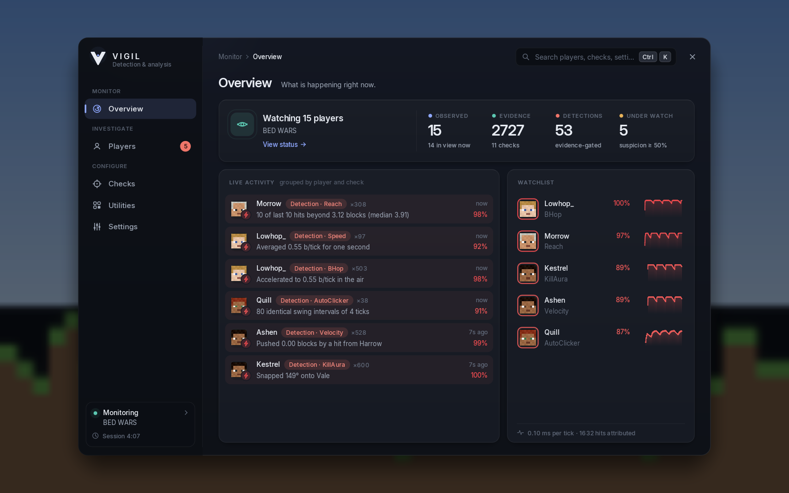

# UI / UX

## Architecture

The interface is drawn natively with OpenGL inside Minecraft's frame (SwapBuffers hook), not
with Minecraft's GUI system. When the menu opens, Vigil displays its embedded `VigilMenuScreen`
subclass so the game releases the mouse and stops player input; window input is routed to the UI
through the window-procedure hook.

| Layer | File | Notes |
|---|---|---|
| Renderer | `src/ui/gfx.*` | Anti-aliased rounded rects, gradients, soft shadows, rings, arcs, strokes, polygons; clip/alpha/offset stacks; frosted backdrop blur; full GL state save/restore |
| Typography | `src/ui/font.*` | Embedded Inter (Regular, Medium, SemiBold, Display SemiBold) rasterized through GDI glyph outlines at exact pixel sizes; kerning; ellipsis and wrapping |
| Icons & mark | `src/ui/icons.*` | 45 original stroke icons on a 20-unit grid; the Vigil mark |
| Motion | `src/ui/anim.h` | Springs with sub-stepping, curated easing curves, Full/Reduced/Off |
| Themes | `src/ui/theme.*` | Five complete themes + accent choices |
| Widgets | `src/ui/widgets.*` | Immediate-mode controls with retained animation state; setting rows generated from the registry |
| Shell & pages | `src/ui/app.cpp`, `page_*.cpp` | Navigation rail, transitions, toasts, five pages |

Layout is in density-independent units; the scale follows the window height and the user's
*Interface scale* setting.

## Information architecture

| Page | Purpose |
|---|---|
| **Overview** | Live status: players observed, evidence, detections, players under watch; live activity feed; watchlist with confidence rings and suspicion sparklines; engine cost per tick |
| **Checks** | Category → searchable check list with inline toggles → detail: how it works, sensitivity presets, indicators (toggle, weight, session count), Detection / Confidence / Sampling / Debug groups, advanced settings on demand, live debug output |
| **Evidence** | Player list → header (suspicion, status, history, report) → timeline (suspicion curve, per-check lanes, detection markers, 1 min / 5 min / 15 min / session) → observation list with check filters → inspector (reasoning, confidence contribution, measured values against limits, debug) |
| **Players** | Behavior profile independent of verdicts: combat (hits, reach distribution vs. vanilla), clicking and movement (speed trace vs. sprint-jump envelope), confidence by check with history, generated pattern insights |
| **Settings** | General (monitoring, where checks run, calibration, menu key), Alerts, Suspect Highlight, Exemptions, Hit attribution, Appearance (theme gallery, accent swatches, scale, motion, blur), Data, About |

## Workflow lessons (Vape V4, Prestige) — adapted, not copied

- Category → module → settings drill-down with inline toggles in the list.
- Search over check names and summaries.
- Presets before knobs; advanced settings behind a disclosure.
- Keyboard: `Ctrl+1…5` switches pages, `Esc` closes popups, then fields, then the menu.

## Education

- Every setting row shows the label, a one-line description, and an info icon whose tooltip
  explains what the setting does. Tooltips never contain recommended values.
- Defaults appear separately: a tick mark on slider tracks and the reset button's tooltip
  ("Reset to default · 3.30 blocks"). Modified settings get an accent dot.
- Quality-reducing states show an inline warning (e.g. sampling on, an indicator off, latency
  compensation below 3 ticks, analyzing lobbies).
- Each check has a "how it works" paragraph; each piece of evidence carries its own reasoning.

## Motion signatures

| Interaction | Motion |
|---|---|
| Open | Backdrop blur and tint fade in; window rises 22 dp with an emphasized decelerate (0.42 s) |
| Close | Reverse with a quick out-cubic (0.22 s) |
| Navigation | Nav indicator glides on a spring; page content fades and rises 10 dp |
| Toggle | Knob travels on an under-damped spring and stretches while pressed |
| Slider | Knob grows on hover/drag with a soft glow; value bubble springs |
| Segmented control | Selection pill glides between options |
| Feed items | Slide in from the left and fade as they arrive |
| Confidence rings, metrics | Values ease toward targets (count-up) |
| Tooltips | 350 ms intent delay, fade and 4 dp rise |
| Toasts | Slide in from the right on a spring, restack smoothly, drain a time hairline |
| Detections | Badge pulse on the Evidence nav item |

*Reduced* motion keeps state changes (stiffer, no overshoot, no travel); *Off* is instant.

## Themes

| Theme | Character |
|---|---|
| Midnight (default) | Ink graphite, iris accent, soft shadows, frosted backdrop |
| Vesper | Warm espresso surfaces, candle-gold accent |
| Obsidian | True black, hairline borders, no shadows, mint accent, stronger tint |
| Glacier | Light workspace, cool paper tones, deep-iris accent, lighter shadows |
| Aurora | Blue-violet depth, cyan signal, stronger accent glow |

Each theme defines surfaces, borders, highlights, radii, shadow strength, glow, backdrop tint and
blur, severity scale and chart palette. Accents override the signature color and are darkened
automatically on light surfaces to keep contrast.

## In game

- **Toasts** (top right) for each detection: confidence ring, check, player, top reason.
- **Chat alert**: `[Vigil] Name · Check 82%`; hover shows the evidence; click runs `/wdr` (or
  opens the player in Vigil when *Click to report* is off).
- **Suspect Highlight**: outlines players above the threshold in world space, colored from
  amber to red by suspicion, with an optional faint tinted volume.

## Verification

`tools/preview` renders the real UI and engine against a simulated arena and writes PNG
screenshots (`VigilPreview.exe --shot out.png --page evidence --theme 3`). All pages and all five
themes were rendered and reviewed; layout defects found this way (indicator columns, truncated
sensitivity text, header width) were fixed.
